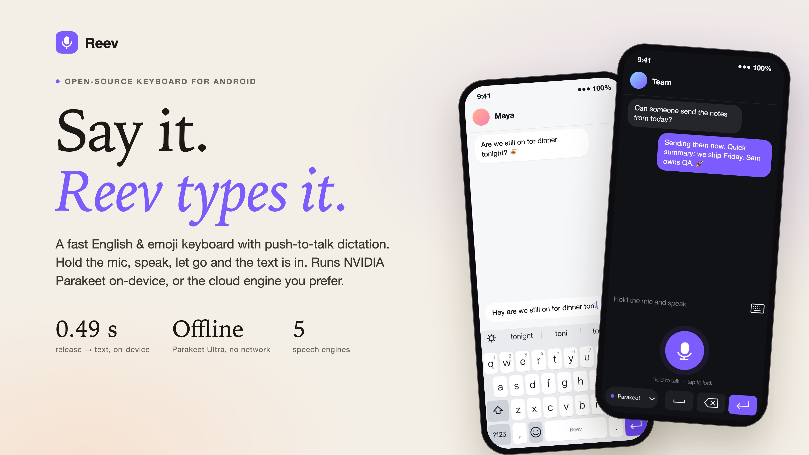
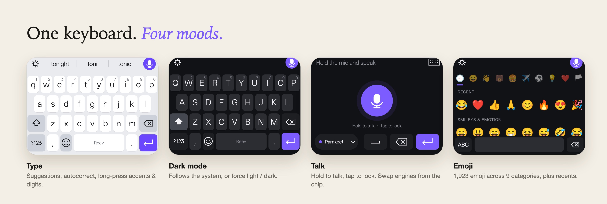
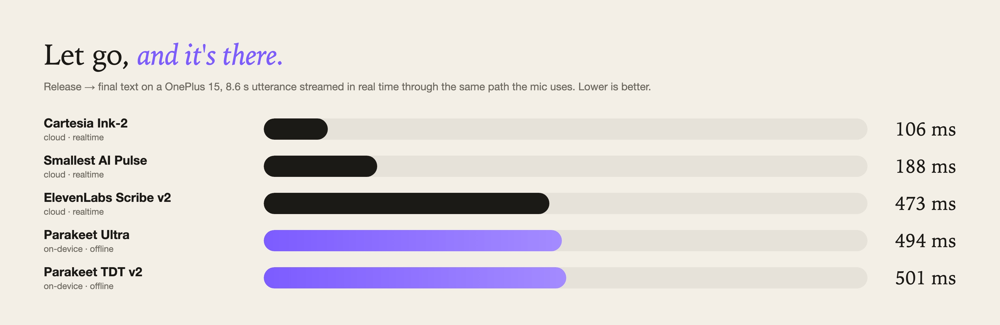

<p align="center">
  
</p>

<p align="center">
  <b>The open-source Android keyboard you can talk to.</b><br>
  English &amp; emoji typing, plus push-to-talk dictation that runs on your phone or in the cloud.
</p>

<p align="center">
  
  
  
  
  
</p>

<br>

## Talk in three moves

<table>
<tr>
<td width="33%" valign="top">

### 1 · Tap the mic
The mic sits in the top bar of the keyboard. One tap and the keys give way to a single, big talk button.

</td>
<td width="33%" valign="top">

### 2 · Hold &amp; speak
Your words stream live into the top strip as you talk. Want to go hands-free? A short tap locks it on.

</td>
<td width="33%" valign="top">

### 3 · Let go
Release, and polished text lands where your cursor is: punctuated, capitalised, with the *ums* and *uhs* gone.

</td>
</tr>
</table>

<p align="center"></p>

## What makes Reev different

<table>
<tr>
<td width="50%" valign="top">

**🔒 Private by default**<br>
Parakeet Ultra runs entirely on the phone: no network, no account, nothing leaves the device.

</td>
<td width="50%" valign="top">

**⚡ Built for speed**<br>
The model stays warm in memory, and the mic starts the moment your finger lands. Text arrives about half a second after you let go.

</td>
</tr>
<tr>
<td valign="top">

**🎛️ Your engine, your call**<br>
On-device NVIDIA Parakeet, or ElevenLabs, Cartesia, Smallest AI and Sarvam over realtime streaming. Switch from the chip in the voice panel.

</td>
<td valign="top">

**⌨️ A real keyboard, too**<br>
Suggestions, gentle autocorrect, long-press accents and digits, cursor swipe on the space bar, and 1,923 emoji.

</td>
</tr>
<tr>
<td valign="top">

**🌗 Light, dark, or both**<br>
It follows your system theme, or you can pin it to light or dark. The change applies instantly.

</td>
<td valign="top">

**🫧 Keyboard only, always**<br>
No floating bubbles, overlays or toasts. Reev never draws outside its own keyboard.

</td>
</tr>
</table>

<p align="center"></p>

## Engines

| | Engine | Runs | Model |
|---|---|---|---|
| 🟣 | **Parakeet Ultra** *(default)* | on-device · offline | Moondream's upgrade of NVIDIA `parakeet-tdt-0.6b-v3`, int8 via sherpa-onnx |
| 🟣 | NVIDIA Parakeet TDT 0.6B v2 | on-device · offline | `parakeet-tdt-0.6b-v2`, int8 via sherpa-onnx |
| ⚫ | ElevenLabs | realtime WebSocket | `scribe_v2_realtime` |
| ⚫ | Cartesia | realtime WebSocket | `ink-2` |
| ⚫ | Smallest AI | realtime WebSocket | `pulse` |
| ⚫ | Sarvam | realtime WebSocket (beta) | `saaras:v3-realtime` |

<details>
<summary><b>Full benchmark numbers</b></summary>

<br>

Measured on a OnePlus 15 (Snapdragon 8 Elite Gen 5, Android 16). Each engine got the same 8.6 s utterance, streamed at real-time pace through the same code path the mic uses (`BenchReceiver`).

| Engine | First partial | Release → final | Transcript |
|---|---|---|---|
| Parakeet Ultra (warm) | 0.81 s | **0.49 s** | exact |
| Parakeet Ultra (cold, model load 2.7 s) | 3.5 s | 0.97 s | exact |
| Parakeet TDT v2 (warm) | 0.82 s | 0.50 s | exact |
| Cartesia ink-2 | 1.71 s | **0.11 s** | exact |
| Smallest pulse | 1.08 s | 0.19 s | missed one sentence break |
| ElevenLabs scribe_v2_realtime | 2.29 s | 0.47 s | exact |
| Sarvam | — | — | not benchmarked yet |

Real-mic check (audio played from a speaker into the phone's mic): Parakeet Ultra transcribed 10.9 s of speech in 650 ms, word for word.

</details>

## Get started

1. **Build & install** the APK (see *Build from source* below).
2. **Open Reev** and complete the three setup steps: enable it, switch to it, and allow the microphone.
3. **Choose a voice engine.** Download Parakeet Ultra in the app (~630 MB, one time, resumable), or paste an API key for ElevenLabs, Cartesia, Smallest or Sarvam.
4. In any text field, tap the mic and talk.

<details>
<summary><b>Build from source</b></summary>

<br>

```bash
# JDK 21 · Android SDK 36 · AGP 8.13 · Gradle 9
./tools/fetch_deps.sh        # one-time: sherpa-onnx AAR → app/libs
./gradlew assembleRelease    # or: ./tools/deploy.sh to build + install over USB

# optional (debug builds): push API keys from env vars instead of typing them
REEV_CARTESIA_KEY=... python3 tools/inject_keys.py
```

Benchmark any engine on a connected phone:

```bash
adb push test.wav /sdcard/Android/data/com.asis.reev/files/test.wav
adb shell am broadcast -n com.asis.reev/.BenchReceiver --es engine local \
    --es wav /sdcard/Android/data/com.asis.reev/files/test.wav
adb logcat -s ReevBench
```

Download models from inside the app. If you `adb push` them into `Android/data/com.asis.reev`, they end up owned by the shell user and the app can't read them.

</details>

## FAQ

<details>
<summary><b>Is "Parakeet Ultra" an NVIDIA model?</b></summary>
<br>
It's built on one. Parakeet Ultra is Moondream's further-trained version of NVIDIA's <code>parakeet-tdt-0.6b-v3</code>: same 0.6B architecture, lower error rate. If you want NVIDIA's own weights, Reev also ships NVIDIA's English-only Parakeet TDT v2.
</details>

<details>
<summary><b>Does my voice leave the phone?</b></summary>
<br>
Not with the Parakeet engines; they're fully offline. With a cloud engine, audio streams directly from your phone to the provider you picked. There's no Reev server in between.
</details>

<details>
<summary><b>Where are my API keys stored?</b></summary>
<br>
In the app's private storage on your phone, and they're only sent to the matching provider. For a wide public release you'd want short-lived tokens from a backend instead.
</details>

<details>
<summary><b>Which phones does it support?</b></summary>
<br>
Android 8.0+ phones on arm64 or armv7. On-device dictation works best on recent flagship chips; older phones may prefer a cloud engine.
</details>

## Honest limitations

- Parakeet isn't a streaming model. Live text comes from re-decoding the growing buffer every 0.7 s, which costs battery on long dictations. Reev doesn't use the phone's NPU yet.
- No glide typing or next-word prediction yet, and English only.
- Release APKs are currently signed with a debug key, so they're for sideloading.
- Emoji come without skin-tone variants for now.

## Credits

Ideas for dictation polish (keeping the model warm, removing fillers, detecting a silent mic, windowing long audio) came from studying [Spokenly](https://spokenly.app). The flow was inspired by [Wispr Flow](https://wisprflow.ai).

- [sherpa-onnx](https://github.com/k2-fsa/sherpa-onnx) (Apache-2.0): on-device inference
- [Parakeet Ultra](https://huggingface.co/moondream/parakeet-ultra) by Moondream (CC-BY-4.0); int8 ONNX export by `mldecode`
- [NVIDIA Parakeet TDT 0.6B v2](https://huggingface.co/nvidia/parakeet-tdt-0.6b-v2) (CC-BY-4.0)
- Word frequencies: [hermitdave/FrequencyWords](https://github.com/hermitdave/FrequencyWords) (CC-BY-SA-4.0)
- Emoji data: Unicode `emoji-test.txt` v18

Models are downloaded at runtime, not bundled.

<p align="center"><sub>Made in Bangalore · speak freely</sub></p>
